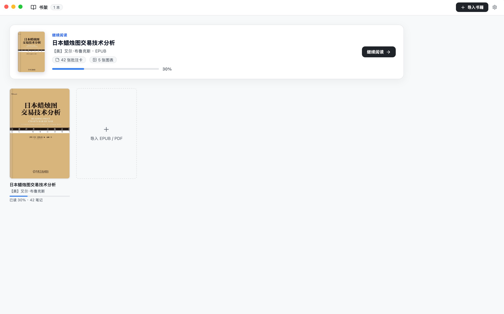
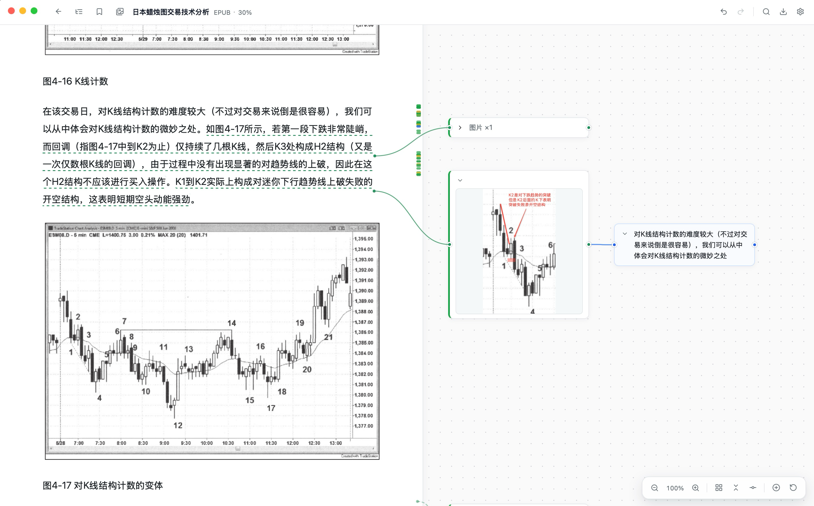

# ReadingBook

**左侧沉浸读书 + 右侧无限批注画布**的桌面阅读器。书页与批注共享同一条原生滚动轴，跨层 SVG 引线把你划线的句子和右侧的想法精确连在一起。

基于 Tauri 2 + React 19 + SQLite，支持本地 EPUB / PDF 导入、书架管理、目录跳转与阅读进度记忆。



<p align="center"><sub>书架：内置一套可直接体验的示例，也可导入自己的 EPUB / PDF</sub></p>

## 为什么不一样

普通阅读器把笔记塞进侧栏列表，和正文是两个世界；白板工具（Miro、Heptabase）能画思维网，但读不了书。ReadingBook 把两者放进同一套坐标系：

- **垂直方向天生同步**：书页和画布在同一个 flex 容器里共享一条滚动条，翻页时卡片跟着走，不需要任何 JS 补偿，所以没有 1–2 帧的视觉滞后。
- **水平方向无限延展**：右侧画布向右无限延伸，书页用 `position: sticky` 钉在左边，平移到第 5 层子卡片时依然能看见原文。
- **引线不遮挡正文**：划词跨行时自动选取中间行的行尾矩形作锚点；锚点右侧还有同行文字时，引线先下探到行间隙、绕过文字再弯向卡片。


<p align="center"><sub>内置示例：每一根引线都从原文的具体词句出发，右侧卡片可以继续向右延伸成思维网</sub></p>

## 功能

**阅读**

- 本地 EPUB / PDF 导入，书架显示封面、作者与阅读进度
- EPUB：OPF 元数据、`nav.xhtml` / `toc.ncx` 多级目录、小节级 fragment 精确跳转、行内粗体/斜体/上下标
- PDF：目录大纲、`IntersectionObserver` 分页虚拟化、离屏页面 `page.cleanup()` 回收内存
- 主题（浅色 / 护眼 / 深色）、字体（系统 / 宋体 / 黑体）、字号、行高、书页宽度，拖动书页右边缘可调宽
- 重新打开自动恢复到上次的阅读位置与滚动偏移

**批注**

- 划词弹出工具栏：高亮、划线、连到已有卡片
- 卡片高度随文字与图片自适应，悬停才出现工具胶囊；`Cmd+V` 粘贴截图、拖入图片、点击缩略图打开灯箱
- 双向连线：书 → 卡片、卡片 → 书、卡片 → 卡片；右侧 `+` 快速派生分支
- 卡片可像思维导图一样收起 / 展开，收起时连带隐藏整棵子树并显示后代数量；右上角可一键全部收起或全部展开，折叠状态切换后会自动重排一次布局
- 新建卡片做纵向碰撞检测，一键整理按连线拓扑做对称树状排列
- 卡片原图存 IndexedDB，SQLite 只记 id，重开时按需重建缩略图

**桌面集成**

- macOS 顶栏透明叠加，红绿灯浮在内容上，整条栏可拖动窗口、双击最大化
- 书籍与进度存本地 SQLite，设置跟着应用走
- 大文件按需读取：142MB 的 EPUB 只把中央目录、当前章节和视口内图片读进内存



## 技术栈

| 层 | 选型 |
| --- | --- |
| 桌面壳 | Tauri 2（Rust 1.90+） |
| 前端 | React 19 + TypeScript + Vite 6 |
| 存储 | `tauri-plugin-sql`（SQLite）+ IndexedDB（卡片原图） |
| EPUB | [zip.js](https://github.com/gildas-lormeau/zip.js) 自定义 `Reader` 直读磁盘字节区间 |
| PDF | [PDF.js](https://github.com/mozilla/pdf.js) 自定义 `PDFDataRangeTransport` |
| 图标 | [lucide-react](https://lucide.dev/) |

## 快速开始

前置：Node.js 20+、Rust 1.90+、Xcode Command Line Tools（macOS）。

```sh
npm install
npm run tauri dev                  # 开发（Vite HMR + Rust 热重启）
```

打包：

```sh
npm run tauri build -- --bundles app  # 产出 src-tauri/target/release/bundle/macos/ReadingBook.app
```

只要前端预览的话（书架会提示需要桌面版，示例文档与画布可正常体验）：

```sh
npm run dev
```

### 应用图标

源图是 `src-tauri/icon.png`（1254×1254）。改动后重新生成全套图标：

```sh
npx tauri icon src-tauri/icon.png
```

## 目录结构

```
src/
  App.tsx                    窗口外壳、书架/阅读切换、导入删除、设置读写
  ReaderView.tsx             阅读工作区：滚动物理、卡片放置、连线、持久化
  components/
    ShelfView.tsx            书架
    BookPane.tsx             EPUB 正文渲染与划词选区
    PdfBookPane.tsx          PDF 分页渲染与文本层
    AnnotationCard.tsx       批注卡片
    BookToCanvasBridge.tsx   跨层 SVG 引线引擎（RAF，零重渲染）
    SettingsPanel.tsx        阅读设置
  services/db.ts             SQLite 访问
  services/library.ts        导入、封面生成、删除
  utils/epubLoader.ts        EPUB 解析、目录、磁盘区间读取
  utils/imageStore.ts        IndexedDB 图片存取
  styles.css                 Plan A Sticky 布局与主题变量
src-tauri/
  src/lib.rs                 SQLite 迁移与按需读取命令（book_file_size / read_book_range）
  migrations/0001_init.sql   books / book_annotations / settings 三张表
  tauri.conf.json            窗口、bundle、asset 协议配置
  icons/                     打包用图标（由 icon.png 生成）
docs/                         截图（书架 / 阅读工作区 / EPUB）
ARCHITECTURE.md              需求演进、架构选型、算法与内存实测
```

## 数据位置（macOS）

| 内容 | 路径 |
| --- | --- |
| 数据库 | `~/Library/Application Support/com.readingbook.app/readingbook.db` |
| 书籍文件 | `~/Library/Application Support/com.readingbook.app/books/` |
| 封面 | `~/Library/Application Support/com.readingbook.app/covers/` |
| 卡片原图 | WebView 的 IndexedDB（`readingbook-images`） |

删掉整个 `com.readingbook.app` 目录即可清空全部数据。

## 已知限制

- 目前只在 macOS 上验证过打包与运行；Windows / Linux 的理论目标已配置，未实测。
- 批注锚点是「段落下标 + 字符偏移」，跨版本改书会失效（CFI 基础路径已生成但未用于迁移）。
- 尚未支持全书检索、画布缩放与导出。

## 待办

- Markdown / Obsidian 导出，`pdf-lib` 写回原生 PDF 批注层
- 画布缩放与小地图
- 批注数据结构对齐 W3C Web Annotation Data Model，为跨端同步做准备

更详细的需求清单、方案对比与性能数据见 [ARCHITECTURE.md](ARCHITECTURE.md)。
