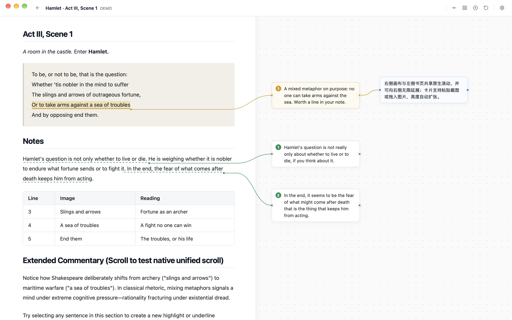

# ReadingBook

**左侧沉浸读书 + 右侧无限批注画布**的跨端阅读器（macOS 桌面端 + Android 移动端）。桌面端让书页与批注共享同一条原生滚动轴，跨层 SVG 引线把你划线的句子、图表和右侧的想法精确连在一起；移动端提供单栏沉浸阅读、底部批注卡片树、在线 Edge Neural TTS 听书与 WiFi 局域网双向同步。

基于 Tauri 2 + React 19 + SQLite（v2 规范化表结构），支持本地 EPUB / PDF 导入、macOS 书架拖拽导入、四色图文批注、内置图片标注、图卡复盘画廊、在线听书与 20 句智能缓存、带图 Markdown 导出、整库备份及 Mac ↔ Android 局域网免云同步。


<p align="center"><sub>书架：「继续阅读」焦点区展示进度与批注/图表统计，支持点击或直接拖入本地 EPUB / PDF</sub></p>

## 为什么不一样

普通阅读器把笔记塞进侧栏列表，和正文是两个世界；白板工具（Miro、Heptabase）能画思维网，但读不了书。ReadingBook 把两者放进同一套坐标系：

- **垂直方向天生同步**：书页和画布在同一个 flex 容器里共享一条滚动条，翻页时卡片跟着走，不需要任何 JS 补偿，所以没有 1–2 帧的视觉滞后。
- **水平方向无限延展**：右侧画布向右无限延伸，书页用 `position: sticky` 钉在左边，平移到第 5 层子卡片时依然能看见原文。
- **引线不遮挡正文**：划词跨行时自动选取中间行的行尾矩形作锚点；锚点右侧还有同行文字时，引线先下探到行间隙、绕过文字再弯向卡片；选中任意卡片或标注时启用**聚焦降噪**，无关连线自动淡化。
- **跨端无缝协同**：手机端不强塞复杂画布，而是以单栏阅读 + 底部卡片树（Bottom Sheet）呈现同一套批注树；局域网同步时将批注正文与桌面画布坐标的时间戳解耦，手机修改笔记不会破坏 Mac 的画布排版。



<p align="center"><sub>阅读工作区：每一根引线都从原文的具体词句或图表出发，右侧卡片可继续向右延伸成思维网</sub></p>

## 功能

**阅读与导航（macOS + Android）**

- 本地 EPUB / PDF 导入；macOS 支持从 Finder 直接将 `.epub` / `.pdf` 拖入书架窗口批量导入；Android 支持 SAF `content://` 魔数识别导入
- 书架顶部「继续阅读」焦点卡片展示进度条、高亮/批注卡/图表统计，封面带书脊光影
- EPUB：OPF 元数据、`nav.xhtml` / `toc.ncx` 多级目录、小节级精确跳转、行内粗体/斜体/上下标、插图自然尺寸缓存
- PDF：目录大纲、`IntersectionObserver` 分页虚拟化、离屏页面 `page.cleanup()` 回收内存
- 焕新版阅读设置（桌面居中卡片 / 移动端底部抽屉），带实时排版预览：主题（浅色 / 护眼 / 深色）、字体（系统默认 / 宋体 / 黑体）、字号、行高、书页宽度（桌面端支持拖动书页右边缘调宽）
- 语义段落/页码定位 + 顶栏实时阅读进度百分比，重开自动恢复阅读位置
- **书页边缘四色微缩热力刻度**：一眼查看全书批注分布，悬停预览原文、点击直达对应段落与卡片

**在线听书（Edge Neural TTS）**

- 纯 Rust 接入微软 Edge Neural TTS（`edge-tts-rust`，支持 WebSocket 连接池复用），无需本地模型文件，macOS 与 Android 双端开箱即用
- 精选 6 款高口碑音色（女声 Top 3：晓晓、晓伊、Ava 双语；男声 Top 3：云希、云健、Andrew 双语），配自定义分组人声选择器
- 支持 `0.85x / 1.0x / 1.25x / 1.5x / 2.0x / 2.5x` 多档倍速（保持原声调不变），支持一键「从当前阅读位置开始朗读」与段落高亮跟随
- **20 句持久化预取缓存（IndexedDB）**：自动预加载后续 20 句音频确保连贯播放；未听过的缓存长期保留，听过的音频在播放完成 2 小时后自动清理

**WiFi 局域网双向同步（Mac ↔ Android）**

- 纯 Rust 实现 UDP 局域网自动发现（`45888` 端口）与嵌入式 HTTP 同步服务（`45889` 端口），无需任何第三方云盘或账号
- 6 位动态配对码（5 分钟有效）建立 HMAC-SHA256 双向鉴权，也支持手动输入局域网 IP 配对
- 增量同步书籍、高亮锚点、批注卡片、卡片连线与二进制文件（`books/`、`covers/`、`images/`），支持字段级时间戳合并（批注内容 `updated_at` 与桌面画布布局 `layout_updated_at` 独立合并）

**四色划词与图文批注**

- **四色语义划词浮条（EPUB & PDF 通用）**：高亮/划线切换 + 4 种语义色（重点黄 / 多头绿 / 警示红 / 思考蓝），自动记忆上次选用颜色与样式；桌面端支持单键盲操（`1`–`4` 四色标注、`H` 高亮、`U` 划线、`Enter` 建空白卡、`C` 复制、`Esc` 关闭）
- **空白建卡 + 自动聚焦 + 全局贴图**：建卡不回填原文，光标直接进入输入框；选中任意卡片后全局按 `⌘V` 即可直接粘贴剪贴板截图
- **标注二次编辑与升级**：点击纯高亮/纯划线或已连卡卡片悬浮栏，随时换色、高亮↔下划线切换；纯标注可一键升级为带连线的批注卡
- **图表快速成卡**：EPUB 插图悬停一键「转成卡片」；PDF 顶栏裁切模式（或随时按住 `⌥` 拖拽）直接从高清 Canvas 框选截图生成锚定卡片
- **内置图片标注器**：点击卡片附图右上角编辑图标，直接在原图上画箭头、趋势线/支撑阻力线（按住 `Shift` 锁定水平/垂直/45°）、矩形框、半透明荧光笔与带白边文字，保存后无损替换

**画布排布与复盘**

- **右侧画布悬浮控制胶囊**：右下角毛玻璃胶囊收纳卡片原地缩放（`50%–120%`，也支持 `⌘+滚轮`）、一键对称自动排列、全部折叠/展开、引线走线模式切换、新建自由卡片与回页边
- **单卡调宽 + 失焦轻量 Markdown 渲染**：拖拽卡片右边缘调宽（`220–520px`）或一键切换标准/宽卡；编辑时纯文本，失焦后渲染 `**加粗**`、`` `代码` ``、`- 列表` 与 `#标签` 胶囊；左侧 3px 语义色条与书页标注联动
- **防漂移与无损撤销**：基于锚点相对偏移 + 同列防重叠算法，字号/书宽/图片加载变化时平滑跟随；支持 `⌘Z` / `⇧⌘Z` 撤销重做
- **批注复盘抽屉**：按四色语义、仅看附图、仅看卡片筛选全书批注，带缩略图预览与一键定位
- **图卡复盘画廊 / 闪卡模式**：顶栏一键打开本书所有带图卡片画廊，支持四色与 `#标签` 筛选，点开进入全屏闪卡模式（`←` / `→` 翻页复盘、一键跳回原书位置）
- **快速搜索（`⌘K`）**：支持检索当前书批注、当前书全文与全书库笔记

**数据安全与迁移**

- **本地文件持久化**：卡片附图原图与缩略图直接落盘于 `$APPDATA/images/`，SQLite 仅保存相对路径
- **带图 Markdown 导出**：选择目标目录后自动生成 `<书名>-笔记/` 文件夹，含 `.md` 文件与同级 `assets/` 附图目录（相对路径引用，可直接拖入 Obsidian / Notion）
- **整库一键备份与恢复**：桌面端设置面板支持一键打包导出或还原完整书库（SQLite 数据库、书籍文件、封面与全部批注图片）


## 技术栈

| 层 | 选型 |
| --- | --- |
| 跨端壳 | Tauri 2（Rust 1.90+，macOS + Android） |
| 前端 | React 19 + TypeScript + Vite 6 |
| 存储 | `tauri-plugin-sql`（SQLite v2 规范化表）+ 本地磁盘 `$APPDATA/{books,covers,images}/` |
| 在线听书 | [edge-tts-rust](https://crates.io/crates/edge-tts-rust)（异步 WebSocket 连接池）+ IndexedDB 20 句预取缓存 |
| 局域网同步 | 纯 Rust UDP 广播发现（45888）+ Tokio 嵌入式 HTTP 服务（45889）+ HMAC-SHA256 |
| EPUB | [zip.js](https://github.com/gildas-lormeau/zip.js) 自定义 `DiskRangeReader` 直读磁盘字节区间 |
| PDF | [PDF.js](https://github.com/mozilla/pdf.js) 自定义 `DiskRangeTransport` |
| 图标 | [lucide-react](https://lucide.dev/) |

## 快速开始

前置：Node.js 20+、Rust 1.90+、Xcode Command Line Tools（macOS）；打包 Android 另需 Android SDK / NDK 与 JDK 17+。

```sh
npm install
npm run tauri dev                  # macOS 开发（Vite HMR + Rust 热重启）
```

**打包 macOS 安装包**（产出 `.app` 与 `.dmg`）：

```sh
./scripts/package.sh               # 产出 src-tauri/target/release/bundle/dmg/ReadingBook_<ver>_<arch>.dmg
```

**打包 Android Release APK 并通过 WiFi ADB 安装**（自动同步图标、使用本地固定 keystore 签名）：

```sh
./scripts/build-android.sh                             # 仅构建并签名 arm64 release APK
./scripts/build-android.sh --install                   # 构建签名并安装到已连接的 adb 设备
./scripts/build-android.sh --install 192.168.1.50:5555 # 连接 WiFi ADB 后安装并启动
```

仅前端预览（书架与局域网同步需要 Tauri 运行时）：

```sh
npm run dev
```

### 应用图标

源图是仓库根目录的 `readingbook.png`（1024×1024，透明背景）。改动后重新生成全套桌面与移动端图标：

```sh
npx tauri icon readingbook.png
```

## 目录结构

```
src/
  App.tsx                        窗口外壳、书架/阅读切换、拖拽导入、同步服务初始化、设置读写
  ReaderView.tsx                 桌面阅读工作区：滚动物理、卡片放置、连线、听书、撤销重做
  MobileReaderView.tsx           移动端单栏阅读器、底部工具栏、听书与抽屉管理
  components/
    ShelfView.tsx                响应式书架、「继续阅读」焦点区、拖拽遮罩与 WiFi 同步入口
    BookPane.tsx                 EPUB 正文渲染、四色锚点与插图一键转卡片
    PdfBookPane.tsx              PDF 分页渲染、文本层与高清框选截图成卡
    SelectionPopover.tsx         四色语义划词浮条与单键快捷键
    AnnotationCard.tsx           桌面批注卡片（语义色条、拖拽调宽、轻量 Markdown 渲染）
    MobileNoteSheet.tsx          移动端底部抽屉批注卡片树（支持追问子卡与改色）
    AnnotationDrawer.tsx         批注复盘抽屉（四色与附图筛选）
    AnchorMinimap.tsx            书页边缘四色微缩热力刻度
    GalleryModal.tsx             图卡复盘画廊与全屏闪卡模式
    ImageAnnotatorModal.tsx      内置图片标注器（箭头/趋势线/方框/荧光笔/文字）
    SearchModal.tsx              ⌘K 全文与跨书批注快速搜索
    BookToCanvasBridge.tsx       跨层 SVG 引线引擎（RAF 零重渲染 + 聚焦降噪）
    TtsPlayerBar.tsx             在线听书控制台与自定义男女声分组人声选择器
    SyncModal.tsx                WiFi 局域网配对、设备发现与一键双向同步弹窗
    SettingsPanel.tsx            阅读设置（实时排版预览 + 桌面/移动自适应）与整库备份
  services/db.ts                 SQLite v2 数据访问（books / anchors / cards / edges / sync_peers / settings）
  services/library.ts            书籍导入（对话框/拖拽/Android SAF）、封面生成、删除
  services/sync.ts               局域网同步协调器与字段级时间戳合并引擎
  utils/ttsEngine.ts             Edge Neural TTS 播放队列、20 句预取与倍速控制
  utils/ttsCache.ts              IndexedDB 音频缓存（未听保留，已听 2 小时自动清理）
  utils/platform.ts              桌面/移动端运行时与响应式断点检测
  utils/epubLoader.ts            EPUB 解析、目录、磁盘区间读取
  utils/epubDimsCache.ts         EPUB 插图自然尺寸缓存
  utils/imageStore.ts            本地磁盘图片存取与缩略图管理
  utils/exportMarkdown.ts        带图 Markdown 导出（含同级 assets 目录）
  styles.css                     Plan A Sticky 布局与主题变量
  mobile.css                     移动端单栏阅读、底部抽屉、听书、同步与新版设置样式
src-tauri/
  src/lib.rs                     SQLite 迁移、区间读取、带图导出、整库备份、TTS 与同步命令注册
  src/tts.rs                     纯 Rust 在线 Edge Neural TTS 合成命令
  src/sync.rs                    纯 Rust UDP 局域网发现 + 嵌入式 HTTP 同步服务与文件拉推
  migrations/0001_init.sql       v2 规范化数据库表结构
  tauri.conf.json                窗口、bundle、asset 协议与 Android 配置
  icons/                         全平台打包用图标（由 readingbook.png 生成）
scripts/
  package.sh                     macOS 一键构建 .app + .dmg 脚本
  build-android.sh               Android 一键同步图标 + 构建签名 Release APK + WiFi ADB 安装脚本
  migrate_v1_to_v2.py            旧版 v1 SQLite 到 v2 规范化表结构的外部无损迁移脚本
docs/                            截图（书架 / 阅读工作区 / EPUB）
ARCHITECTURE.md                  需求演进、架构选型、算法与跨端同步设计
```

## 数据位置（macOS）

| 内容 | 路径 |
| --- | --- |
| 数据库 | `~/Library/Application Support/com.readingbook.app/readingbook.db` |
| 书籍文件 | `~/Library/Application Support/com.readingbook.app/books/` |
| 封面 | `~/Library/Application Support/com.readingbook.app/covers/` |
| 卡片附图 | `~/Library/Application Support/com.readingbook.app/images/` |
| 图片尺寸缓存 | `~/Library/Application Support/com.readingbook.app/cache/` |

删掉整个 `com.readingbook.app` 目录即可清空全部数据（也可先在「阅读设置 → 导出整库备份」中备份）。

## 已知限制

- 已在 macOS（Apple Silicon）与 Android（arm64 Release APK）实测通过；Windows / Linux 理论目标已配置，未实测。
- 批注锚点是「段落下标 + 字符偏移」，跨版本改书会失效（CFI 基础路径已生成但未用于迁移）。

更详细的需求清单、方案对比与跨端同步架构见 [ARCHITECTURE.md](ARCHITECTURE.md)。
